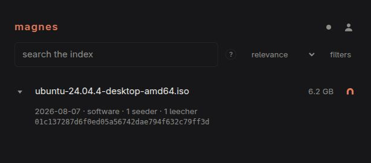

## Search and torrent details

Open the Search page, enter a query, and narrow the results with the available facets.
Change the sort when you need a different ordering. Search state is represented in the
URL, so you can bookmark a query or share it with someone who has access to the same
instance.

Expand a result to inspect its torrent details and available file metadata. Use a magnet
link with your torrent client to download content. The crawler can limit how many file
records it saves, so an incomplete file list does not necessarily mean the torrent
itself is incomplete.

This Ubuntu image has a single file. The date and peer counts reflect stored metadata;
they are not a live availability check.

A newly started crawler needs time to populate the index and process classification
jobs. An empty result is not by itself a crawler failure.

See [text search](../text-search/) for phrase matching, exclusions, prefixes, and grouping.

## Status, jobs, and statistics

Status reports health and workers. Queue jobs lets authorised Users inspect queued work
and filter by queue and status. Torrent and queue statistics show activity in a selected
time window. An empty chart can mean there were no events in that window.

These pages depend on Permissions. Signing in does not automatically grant queue
administration or all statistics. Ask an administrator to review your Role if access
is refused.

## Users and integrations

Your User overview and API keys are available after sign-in. Administrators can manage
Users, Roles, and Invitations. Queue administration includes actions such as purging
jobs and scheduling reprocessing; review their effect before submitting them.

Use one API key per integration so you can revoke a client independently. Browser
sessions and machine API keys are separate credentials.

Use [reprocessing](../reprocessing/) to apply classifier changes to existing torrents,
and [monitoring](../monitoring/) for logs, metrics, and profiling.
