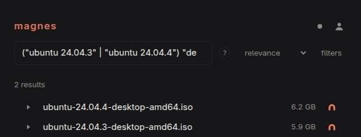

import { Card, CardGrid } from "@astrojs/starlight/components";

<CardGrid>
  <Card title="A catalogue you operate" icon="magnifier">
    Crawl the DHT and classify torrent metadata into a searchable PostgreSQL
    index. Magnes indexes metadata; use your torrent client to download content.
  </Card>
  <Card title="An interface included" icon="computer">
    Search and filter torrents, inspect their details, and follow workers, queue
    jobs, and statistics from the bundled Elm UI.
  </Card>
  <Card title="Control access" icon="approve-check">
    Register Users through Invitations, assign Roles and Permissions, and issue
    API keys for integrations. A fresh installation requires credentials for
    catalogue access.
  </Card>
  <Card title="Connect your tools" icon="puzzle">
    Use Torznab with Prowlarr, Sonarr, and Radarr, or build your own client
    against the GraphQL API.
  </Card>
</CardGrid>

## Search your catalogue

Search results from a running instance, showing Ubuntu desktop installation images.
Your catalogue depends on what your crawler has discovered or you have imported.
Learn how to [use the interface](./guides/interface/) and
[combine search terms](./guides/text-search/).

## Built on Bitmagnet

Magnes is a fork of [Bitmagnet](https://github.com/bitmagnet-io/bitmagnet), with a new Elm
interface and changes to authentication, deployment, and backend behaviour. These docs
cover Magnes. Existing installations should start with the
[migration guide](./getting-started/from-bitmagnet/).
